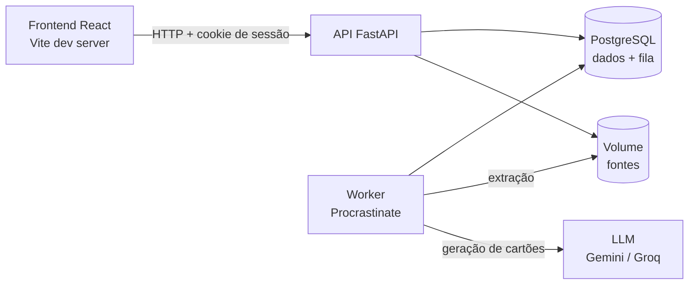
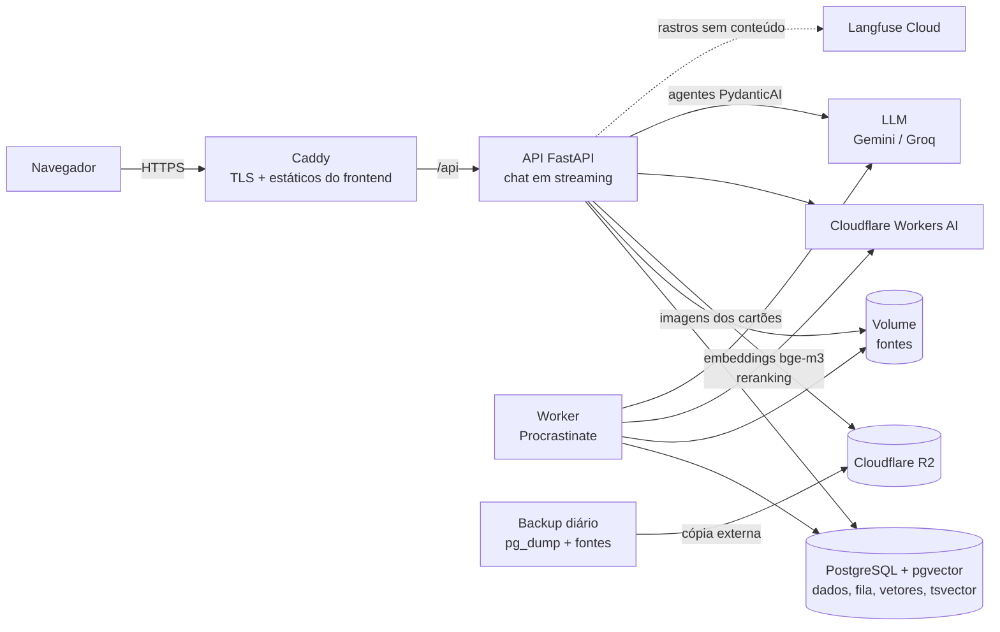

# Arquitetura

**Atualizado em:** 12/10/2026 ([registro da sessão](../prompts/2026-10-12-alinhamento-produto-arquitetura.md))
**Status:** aprovada em 12/10/2026 (registrada por Artur Lins). As decisões e as alternativas de cada camada estão em [`../research.md`](../research.md) (DTEC 002 a DTEC 014).
**Referência pós-acadêmica:** [`referencia-pos-academica.md`](referencia-pos-academica.md)

Este documento descreve a arquitetura **vigente** do projeto em dois estágios: o **MVP**, que roda localmente, e o **final acadêmico**, publicado numa VPS com HTTPS. A arquitetura mais robusta, que o produto adotaria fora do contexto acadêmico, está no documento de referência, junto do custo e do gatilho de cada evolução.

## 1. Princípios

1. **Custo é restrição de projeto.** O deploy é obrigatório e pago pela equipe. Nada roda na VPS sem precisar rodar lá: nenhum modelo local, nenhuma JVM, nenhum broker separado. O alvo do final acadêmico é uma VPS de **2 a 4 GB de RAM** (RQ-09).
2. **Um banco só.** O PostgreSQL guarda dados relacionais, fila de tarefas e, no final acadêmico, vetores (pgvector) e índice textual. Menos serviços significa menos backup, menos falhas e menos memória.
3. **IA atrás de interfaces.** Provedor de LLM, de embeddings e de reranking são trocados por configuração, sem mudar regras de negócio (RQ-05). Por isso trocar a API gratuita por um modelo local no futuro não muda o domínio.
4. **Monólito modular.** Uma API e um worker compartilham o mesmo código, organizado por domínio. Separar serviços só se justifica com carga que o projeto não tem.
5. **Mesmo modelo de embeddings na nuvem e no futuro local.** O bge-m3 roda hoje na Cloudflare e pode rodar localmente depois, com a mesma dimensão (1024). A migração não exige reindexar.

## 2. Visão geral

### 2.1 MVP (local)



### 2.2 Final acadêmico (VPS)



## 3. Stack por estágio

| Camada | MVP | Final acadêmico | DTEC |
|---|---|---|---|
| Linguagem e pacotes do backend | Python, uv | igual | [002](../research.md#decisão-dtec-002-framework-do-backend) |
| Framework | FastAPI, Pydantic, pydantic-settings | igual + streaming (SSE) no chat | 002 |
| ORM e migrações | SQLAlchemy 2 (assíncrono) + asyncpg + Alembic | igual | 002 |
| Autenticação | Própria: Argon2id + sessão opaca no Postgres em cookie HttpOnly | + recuperação de senha por e-mail | [003](../research.md#decisão-dtec-003-autenticação) |
| Frontend | React + TypeScript (strict) + Vite + Tailwind CSS + openapi-typescript | igual | [004](../research.md#decisão-dtec-004-frontend) |
| Banco | PostgreSQL com a imagem `pgvector/pgvector` desde o início | + pgvector (HNSW, cosseno) e `tsvector` em português | [005](../research.md#decisão-dtec-005-banco-de-dados-único) |
| Fila e worker | Procrastinate (fila no Postgres), um contêiner de worker | igual | [006](../research.md#decisão-dtec-006-fila-e-processamento-assíncrono) |
| Agentes e LLM | PydanticAI; Gemini (camada gratuita), Groq como alternativa | + agentes do chat e do tira-dúvidas, busca como ferramenta; LangGraph em reavaliação | [007](../research.md#decisão-dtec-007-llm-e-framework-de-agentes) |
| Embeddings e reranking | Não há | bge-m3 (1024) e reranker no Workers AI da Cloudflare | [008](../research.md#decisão-dtec-008-embeddings-e-reranking) |
| Extração | PyMuPDF (PDF com texto), leitura direta de TXT e MD | + SRT, VTT, DOCX | [009](../research.md#decisão-dtec-009-extração-de-texto) |
| Arquivos | Volume Docker (fontes) | Volume (fontes) + Cloudflare R2 (imagens dos cartões, até 3 MB) | [010](../research.md#decisão-dtec-010-armazenamento-de-arquivos) |
| Observabilidade | Logs JSON com id de correlação, `/health`, tabela de consumo da IA | + Langfuse Cloud sem conteúdo dos materiais; avaliações com pydantic-evals | [011](../research.md#decisão-dtec-011-observabilidade-e-avaliação-da-ia) |
| Repetição espaçada | Biblioteca `fsrs` (implementação oficial em Python do FSRS) | igual | [012](../research.md#decisão-dtec-012-algoritmo-de-repetição-espaçada) |
| Hospedagem | Docker Compose local | VPS (provável Hetzner) + Docker Compose + Caddy | [013](../research.md#decisão-dtec-013-hospedagem-e-operação) |
| Testes | pytest (DTEC 001) + pytest-asyncio + httpx + Postgres real; Vitest + Testing Library + MSW | + Playwright na jornada principal | [014](../research.md#decisão-dtec-014-complementos-de-teste) |

## 4. Contêineres e dimensionamento

| Contêiner | MVP | Final | RAM estimada |
|---|---|---|---|
| `db` (PostgreSQL + pgvector) | sim | sim | 0,3–0,6 GB |
| `api` (FastAPI, Uvicorn) | sim | sim | 0,15–0,3 GB |
| `worker` (Procrastinate, mesmo código da API) | sim | sim | 0,15–0,3 GB |
| `web` (servidor de desenvolvimento do Vite) | sim | não | — |
| `caddy` (TLS, proxy e estáticos do frontend) | não | sim | 0,03–0,05 GB |
| Sistema operacional e folga | — | — | 0,3–0,5 GB |
| **Total do final acadêmico** | | | **~1,0–1,8 GB** |

Os valores são estimativas, a medir no ensaio de deploy. Uma VPS de **4 GB** deixa folga para picos de extração e para a construção do índice HNSW. As imagens são construídas na integração contínua, não na VPS.

Comparação com o esboço anterior (Keycloak, Redis, Celery, bge-m3 local e Langfuse self-hosted): ~6–9 GB. A diferença é o que a [referência](referencia-pos-academica.md) justifica.

## 5. Backend

### 5.1 Organização (MVC por domínio)

O backend é um monólito modular, organizado por domínio, com as camadas MVC identificáveis em cada módulo ([padrões de implementação](../skills/padroes-implementacao.md)):

| Domínio | Responsabilidade | Estágio |
|---|---|---|
| `identidade` | Cadastro, login, sessão, perfil e preferências | MVP |
| `materias` | Matérias | MVP |
| `fontes` | Envio, validação, armazenamento, processamento, trechos, exclusão | MVP |
| `cartoes` | Cartões manuais, geração, revisão dos gerados, origem e evidência | MVP |
| `revisao` | Lições, autoavaliação, FSRS, idempotência | MVP |
| `gamificacao` | XP, meta, dia de estudo, sequência | MVP |
| `evolucao` | Consolidação dos indicadores | MVP |
| `ia` | Interfaces e adaptadores de LLM, embeddings e reranking, consumo, limites | MVP (LLM) / Final |
| `busca` | Indexação, busca híbrida, RRF, reranking | Final |
| `chat` | Conversas, mensagens, citações, tira-dúvidas | Final |

Mapeamento MVC: **Model** = entidades SQLAlchemy, regras de domínio, serviços e repositórios; **Controller** = routers do FastAPI (finos, sem regra de negócio); **View** = o frontend React. A estrutura de pastas definitiva é registrada no primeiro `plan.md`.

### 5.2 Autenticação e sessão

- Senha com **Argon2id**; mensagens de erro de login que não revelam se o e-mail existe; limite de tentativas por IP e por conta.
- Sessão **opaca** (identificador aleatório, armazenado com hash no Postgres) em cookie `HttpOnly`, `Secure` e `SameSite=Lax`. Nenhum token fica acessível ao JavaScript, o que encerra a [QA-25](../produto/pendencias.md#qa-25-sessão-no-navegador-migração-para-bff).
- Requisições que alteram estado exigem um cabeçalho anti-CSRF (*double submit*). Logout e expiração revogam a sessão no servidor.
- Frontend e API ficam na mesma origem (Caddy encaminha `/api`), o que dispensa CORS.

### 5.3 Processamento assíncrono

Tarefas do Procrastinate, idempotentes e com estados visíveis (RN-03):

| Tarefa | O que faz | Estágio |
|---|---|---|
| `processar_fonte` | Extrai texto, divide em trechos com página e posição, persiste | MVP |
| `gerar_cartoes` | Seleciona trechos, chama o agente gerador, valida estrutura e sustentação, grava como "aguardando revisão" | MVP |
| `indexar_fonte` | Gera embeddings (bge-m3) e o `tsvector` dos trechos | Final |
| `backup` | `pg_dump` e cópia das fontes para o R2 | Final |

### 5.4 IA

- **Interface própria** para cada capacidade (gerar cartões, responder no chat, embutir texto, reordenar trechos), com adaptadores por provedor. Provedor, modelo e chaves vêm do ambiente.
- **PydanticAI** define os agentes com saída tipada (modelos Pydantic). No MVP há um agente, o gerador de cartões. No final acadêmico entram o agente do chat e o do tira-dúvidas, que usam a busca como ferramenta.
- **Limites operacionais** (guidelines): timeout, até 2 novas tentativas com espera crescente, orçamento diário de chamadas por estudante, e registro do consumo por chamada (provedor, modelo, tokens, latência, custo estimado, versão das instruções).
- **Conteúdo é dado.** Trechos entram no prompt delimitados e rotulados como material do estudante. Instruções do sistema nunca são concatenadas ao conteúdo (CB-15).
- **Privacidade.** Na camada gratuita do Gemini, o provedor pode usar o conteúdo enviado para melhorar seus produtos. O estudante é informado disso na primeira geração (Princípio II). O Groq é a alternativa configurável.

### 5.5 RAG no final acadêmico

```text
trechos por estrutura (página/seção, com sobreposição)
  -> embeddings bge-m3 (Workers AI) + tsvector 'portuguese'
  -> busca vetorial (HNSW, cosseno) e textual, filtradas por estudante e matéria
  -> fusão por RRF
  -> reranking (Workers AI; avaliar qualidade em português)
  -> contexto delimitado -> agente responde com citações ou declara falta de evidência
  -> busca agêntica: o agente pode reformular e buscar de novo, com limite de iterações
```

- O filtro por estudante e matéria é aplicado **na consulta**, nunca depois da recuperação (RN-01).
- Cada embedding registra o modelo e a versão que o geraram.
- **Avaliação** (aula 04): o conjunto de casos (mínimo de 15, com casos ambíguos, sem evidência e adversariais) compara o pipeline completo com a **solução de referência** só com busca textual, medindo evidência e correção.

### 5.6 Arquivos

- **Fontes:** volume Docker, com nome interno (UUID) e metadados no banco. O nome enviado pelo usuário nunca é usado como caminho.
- **Imagens dos cartões (final):** Cloudflare R2 via API compatível com S3. O backend valida o tipo real (JPEG, PNG ou WebP) e o tamanho (até 3 MB) antes de gravar. A leitura usa URLs assinadas de curta duração, porque as imagens são privadas. Camada gratuita: 10 GB armazenados, 1 milhão de escritas e 10 milhões de leituras por mês, sem custo de saída.

## 6. Frontend

- React + TypeScript (strict) + Vite + Tailwind CSS. Os tipos da API são gerados do OpenAPI com `openapi-typescript`.
- Os tokens de design (cores, tipografia, espaçamento) ficam centralizados na configuração do Tailwind, com tema claro e escuro ([design](../base-specs/design.md)).
- A trilha é um componente próprio, sem biblioteca de componentes que imponha aparência.
- O frontend não calcula XP, agendamento, sequência nem domínio. Ele exibe o que o servidor devolve (Princípio IV).

## 7. Operação do final acadêmico

| Exigência das guidelines | Como é atendida |
|---|---|
| URL com HTTPS | Caddy com certificado automático; domínio próprio ou DNS curinga |
| Dados persistentes | Volumes do Postgres e das fontes |
| Logs e verificação de saúde | Logs JSON; `/health` (processo vivo) e `/health/ready` (banco e fila acessíveis) |
| Backup e restauração testados | `pg_dump` diário + fontes, copiados para o R2; restauração ensaiada e registrada no runbook |
| Rollback documentado | Imagens versionadas por *tag* no registro; voltar = apontar o Compose para a *tag* anterior e aplicar a migração reversa, quando houver |
| Testes no pipeline | Integração contínua executa a suíte completa antes do merge na `main` (QA-30) |
| Limites e consumo da IA | Timeout, novas tentativas limitadas, orçamento por estudante e tabela de consumo |
| Runbook | Detectar, investigar e recuperar: queda da API, fila parada, provedor de IA indisponível, disco cheio |

## 8. Segurança (resumo)

- Isolamento por estudante em toda consulta, inclusive na busca vetorial e nas URLs assinadas.
- Validação de arquivos por conteúdo real, tamanho e quantidade, no proxy e na aplicação.
- Cabeçalhos de segurança (CSP restritiva, HSTS, `X-Content-Type-Options`) no Caddy.
- Segredos só em `.env` (fora do git) e documentados em `.env.example`.
- Logs sem conteúdo bruto de fontes, perguntas ou respostas.

## 9. Pendências de arquitetura

| Item | Onde |
|---|---|
| Esquema inicial do banco em DBML (próximo passo) | [QA-21](../produto/pendencias.md#qa-21-esquema-inicial-do-banco) |
| Escolha da VPS, do domínio e custo mensal | [QA-11](../produto/pendencias.md#qa-11-vps-e-operação-do-deploy) |
| PydanticAI ou LangGraph para os agentes do final acadêmico | [QA-31](../produto/pendencias.md#qa-31-framework-de-agentes-do-final-acadêmico) |
| Qualidade do reranker em português | DTEC 008, condição para revisão |
