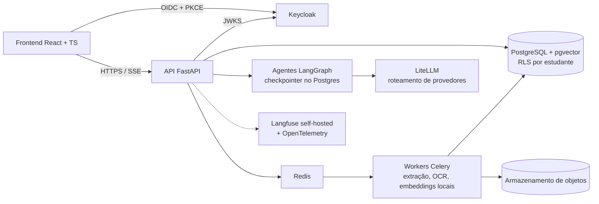

# Arquitetura de referência pós-acadêmica

**Atualizado em:** 12/10/2026 ([registro da sessão](../prompts/2026-10-12-alinhamento-produto-arquitetura.md))
**Origem:** esboço de arquitetura de 12/10/2026 (`docs/init/Architecture.md`, commit `9f0f40d`), reorganizado como referência.
**Status:** documento de referência. **Nada aqui é implementado** nos estágios acadêmicos.

## Propósito

A [arquitetura vigente](README.md) foi simplificada porque o deploy é obrigatório e pago pela equipe. Este documento registra a arquitetura que o produto adotaria se crescesse depois da disciplina. Para cada camada, ele diz **o que a tecnologia resolveria**, **quanto custaria** e **qual gatilho** justificaria adotá-la. A equipe conhece essas tecnologias e escolheu conscientemente não usá-las agora.

Resumo do custo: a pilha de referência precisa de **~6 a 9 GB de RAM** e de serviços gerenciados pagos. A pilha vigente do final acadêmico cabe em **~1 a 2 GB**.

## Visão geral

## Evolução por camada

| Camada | Vigente (final acadêmico) | Referência | O que resolveria | Custo | Gatilho para adotar |
|---|---|---|---|---|---|
| Identidade | Autenticação própria com sessão em cookie | **Keycloak** (OIDC, Authorization Code + PKCE, JWT validado por JWKS com PyJWT; `react-oidc-context` no cliente) | Login social, MFA, recuperação de senha, papéis (ex.: professor), SSO com outros sistemas | JVM de 0,5 a 1 GB de RAM; realm, tema e atualizações para manter | Papéis além do estudante, exigência de MFA ou login institucional |
| Isolamento no banco | Filtro por estudante em toda consulta, coberto por testes de segurança | **Row-Level Security** no Postgres, inclusive na tabela de embeddings | Defesa em profundidade: um bug na aplicação não vaza dados de outro usuário | Complexidade nas migrações e nas conexões (variável de sessão por requisição) | Multi-inquilino (instituições) ou dados sensíveis em volume |
| Fila | Procrastinate (fila no Postgres) | **Celery + Redis** | Alto volume de tarefas, prioridades, agendamento distribuído, vários workers | Redis (~50–200 MB) e mais um serviço para monitorar e salvar | Fila competindo com o banco por recursos, ou milhares de tarefas por hora |
| Embeddings | bge-m3 no Workers AI da Cloudflare (gratuito até o limite diário) | **bge-m3 local** com `sentence-transformers` nos workers (dimensão 1024) | Dados não saem do servidor; sem limite de uso de terceiros | 2 a 3 GB de RAM; indexação lenta em CPU ou GPU dedicada | Exigência de privacidade (dados não podem sair) ou volume acima da camada gratuita. Como o modelo é o mesmo, a migração não exige reindexar |
| Reranking | Reranker no Workers AI | Reranker multilíngue local (ex.: família bge-reranker v2) | Melhor ordenação em português sem dependência externa | ~1 GB de RAM adicional | Avaliação mostrar ganho relevante que justifique o custo |
| Orquestração de agentes | PydanticAI | **LangGraph** com *checkpointer* no Postgres (`langgraph-checkpoint-postgres`) | Fluxos com estado, retomada, aprovação humana no meio do fluxo, grafos multiagentes explícitos | Curva de aprendizado; mais código de orquestração | Fluxos longos com intervenção humana (ex.: plano de estudos a partir de edital, F-14). Em reavaliação para o final acadêmico ([QA-31](../produto/pendencias.md#qa-31-framework-de-agentes-do-final-acadêmico)) |
| Acesso a LLMs | Adaptadores próprios via PydanticAI (Gemini, Groq) | **LiteLLM** como gateway (roteamento, *fallback*, orçamento centralizado) | Troca e combinação de muitos provedores, controle central de custo | Mais um componente (biblioteca ou proxy) | Mais de dois provedores em produção ou necessidade de *fallback* automático |
| Extração | PyMuPDF (PDF com texto), TXT, MD, SRT, VTT, DOCX | **Docling** com OCR; XLSX e PPTX | PDFs digitalizados, tabelas e apresentações | Modelos de layout e OCR: GB de RAM e CPU intensiva | Usuários com material digitalizado em volume relevante |
| Licença da extração | PyMuPDF (AGPL-3.0), aceitável em uso acadêmico não comercial | Licença comercial do PyMuPDF **ou** troca por biblioteca permissiva (pypdf, pdfplumber) ou pelo Docling (MIT) | Evitar a obrigação da AGPL de abrir o código do serviço | Licença paga ou queda de qualidade em layouts complexos | **Qualquer uso comercial** do produto |
| Arquivos | Cloudflare R2 para fontes e imagens (DTEC 010, revisada em 12/10/2026) | Igual, com replicação entre regiões e ciclo de vida dos objetos | Exigência de recuperação de desastre | Custo por armazenamento e operação | Uso acima da camada gratuita |
| Observabilidade de IA | Langfuse Cloud (camada gratuita, sem conteúdo) | **Langfuse self-hosted** | Rastros completos com conteúdo, sem enviar dados a terceiros | ClickHouse, Redis e armazenamento de objetos: vários GB | Necessidade de rastrear conteúdo sob controle próprio |
| Observabilidade geral | Logs JSON, `/health`, tabela de consumo | **OpenTelemetry** (rastros, métricas) com painel e alertas | Diagnóstico distribuído, SLOs e alertas | Coletor e armazenamento de métricas | Mais de um serviço ou exigência de disponibilidade |
| Avaliação de RAG | pydantic-evals no pytest, conjunto de casos revisado | **Ragas** integrado ao pytest, com métricas de fidelidade e relevância | Métricas padronizadas e comparáveis | Chamadas extras de LLM por execução | Ciclo frequente de mudanças no pipeline de RAG |
| Orquestração de contêineres | Docker Compose numa VPS | **Kubernetes** (Deployment, Service, probes, limites, segredos) | Escala, atualização sem indisponibilidade, autorrecuperação | Plano de controle e mais nós | Mais de uma VPS ou exigência de alta disponibilidade. Opcional como aprofundamento na entrega final |
| Frontend: streaming | SSE consumido diretamente | SDK de streaming de IA no cliente (ex.: `ai`, `@ai-sdk/react`) | Componentes prontos de chat em streaming | Dependência adicional | Interface de chat mais rica (anexos, ferramentas visíveis) |
| Testes de integração | Postgres real via Compose | **Testcontainers** (Postgres com pgvector por suíte) | Isolamento total por execução, paralelismo | Docker disponível dentro do executor | Suíte lenta ou testes interferindo entre si |

## O que não muda

A referência mantém as escolhas que já são as melhores disponíveis para o problema, independentemente da escala:

- PostgreSQL como banco único com pgvector (HNSW, `vector_cosine_ops`) e busca híbrida com `tsvector` e RRF.
- FastAPI, SQLAlchemy 2 assíncrono, psycopg 3 (emenda da DTEC 002), Alembic, Pydantic, pydantic-settings e uv.
- React, TypeScript (strict), Vite, Tailwind CSS, `openapi-typescript`, Zod e React Hook Form.
- FSRS como algoritmo de repetição espaçada.
- Ruff, mypy, pytest, pytest-asyncio e httpx no backend; Vitest, Testing Library, MSW, Playwright, ESLint (com `jsx-a11y`) e Prettier no frontend.

## Notas técnicas preservadas do esboço

- O *autogenerate* do Alembic não reconhece bem índices HNSW: declare-os com `postgresql_using="hnsw"`, `postgresql_with` e `postgresql_ops`, e revise sempre a migração gerada. A extensão é criada na migração (`CREATE EXTENSION IF NOT EXISTS vector`).
- A dimensão do embedding fixa o tamanho da coluna `vector(N)`. O bge-m3 usa 1024.
- No E2E com Keycloak, o login é automatizado uma vez e o `storageState` autenticado do Playwright é reaproveitado.

## Privacidade e LGPD (válido em qualquer estágio)

- **Trilha de auditoria:** registrar quais trechos embasaram cada cartão e cada resposta (consulta, trechos recuperados, versão da fonte, modelo, usuário, instante).
- **Retenção e exclusão:** os embeddings saem junto da fonte (RN-14). Dado pessoal vetorizado continua sendo dado pessoal.
- **Transferência a provedores:** documentar o papel de cada provedor de IA e verificar nos termos se a camada gratuita usa o conteúdo para treinar modelos.
- **Logs:** não registrar conteúdo sensível de prompts e respostas sem controle de acesso e prazo de retenção.
