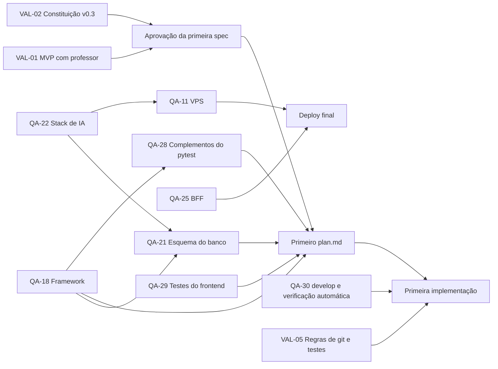

# Pendências e impactos das decisões

**Data:** 29/09/2026
**Origem:** [brainstorming aprofundado](../prompts/2026-09-29-brainstorming-aprofundado.md)
**Responsável geral:** a equipe (Arthur Moura, Artur Lins, Caroline Santana, Pedro Paulo Lucena e William Johnson). Recorte do MVP e decisões de produto são validados com o professor Aldo Nunes (PO).

Este documento reúne o que **ainda não foi decidido**, o que cada pendência bloqueia e o impacto de cada opção. Ele serve de pauta para as reuniões da equipe e com o professor. As decisões já tomadas estão na [visão](visao.md#decisões-do-brainstorming-aprofundado) e o recorte está no [backlog](backlog.md#recorte-do-mvp).

As recomendações abaixo são do agente e **não são decisões**. Uma pendência só é encerrada quando a equipe registra a resposta: questões técnicas vão para um ADR ou `research.md`, e questões de produto para a visão ou a spec. Ao encerrar uma pendência, mova-a para a seção [Encerradas](#encerradas) com a data e o link da decisão, sem apagar o texto.

## Prazos de referência

- **MVP:** 3 semanas a partir de 29/09/2026 (estimativa: 20/10/2026), podendo rodar localmente.
- **Plataforma final:** novembro de 2026, com deploy obrigatório (URL com HTTPS).
- **Caminho crítico:** QA-18 e QA-22 bloqueiam o primeiro `plan.md`. Cada dia sem elas consome o prazo do MVP.

## Resumo

| ID | Pendência | Tipo | Bloqueia | Responsável | Prazo sugerido |
|---|---|---|---|---|---|
| [QA-22](#qa-22-stack-de-ia-llm-embeddings-e-busca) | Stack de IA: LLM, embeddings e busca | Técnica | QA-21, QA-11, plano de F-03, F-04 e F-06 | Equipe | 01/10/2026 |
| [QA-18](#qa-18-framework-do-backend-fastapi-ou-django) | Framework do backend: FastAPI ou Django | Técnica | Primeiro `plan.md`, QA-21, estrutura de pastas | Equipe | 01/10/2026 |
| [QA-21](#qa-21-esquema-inicial-do-banco) | Esquema inicial do banco | Técnica | Primeiro `plan.md` | Equipe | No plano de F-01 |
| [QA-11](#qa-11-vps-e-operação-do-deploy) | VPS, dimensionamento e operação | Técnica e custo | Deploy final | Equipe | Antes do fim do MVP |
| [QA-23](#qa-23-publicação-automática-e-limite-de-novos-cartões) | Publicação automática e limite de novos cartões (provisória) | Produto | Spec de F-04 e F-05 | Equipe e professor | Na spec de F-04 |
| [QA-16](#qa-16-escopo-do-chat) | Escopo do chat (provisória) | Produto | Spec de F-06 | Equipe e professor | Na spec de F-06 |
| [QA-24](#qa-24-valores-da-gamificação) | Valores da gamificação (XP, limiar de domínio, padrões) | Produto | Spec de F-05, F-09 e F-10 | Equipe | Na spec de F-09 |
| [QA-25](#qa-25-sessão-no-navegador-migração-para-bff) | Sessão no navegador: migração para BFF | Técnica e segurança | Deploy final | Equipe | Antes do deploy |
| [QA-04](#qa-04-qualidade-e-verificação-da-geração) | Qualidade e verificação da geração (restante) | Produto e técnica | Spec de F-03 e F-04 | Equipe | Na spec de F-04 |
| [QA-19](#qa-19-identidade-visual-restante) | Identidade visual: nome, paleta e tipografia | Produto | Primeira interface | Equipe | Antes da interface de F-01 |
| [QA-26](#qa-26-níveis-de-dificuldade) | Significado dos níveis de dificuldade (EX-05) | Produto | Spec de F-04 | Professor | Próxima review |
| [QA-27](#qa-27-regras-da-consulta-externa) | Regras da consulta externa (EX-01) | Produto e técnica | Incremento de F-16 (versão final) | Equipe e professor | Antes da spec do incremento |
| [QA-28](#qa-28-complementos-do-pytest) | Complementos do pytest (cliente HTTP, plugins, cobertura) | Técnica | Primeiro `plan.md` | Equipe | No plano de F-01 |
| [QA-29](#qa-29-ferramenta-de-testes-do-frontend) | Ferramenta de testes do frontend | Técnica | Primeira interface | Equipe | No plano de F-01 |
| [QA-30](#qa-30-branch-develop-e-verificação-automática-antes-do-merge) | Branch `develop` e verificação automática antes do merge | Técnica e processo | Primeira implementação | Equipe | Antes da primeira implementação |
| [VAL-01](#val-01-validação-do-mvp-com-o-professor) | Validação do recorte do MVP com o professor | Processo | Aprovação da primeira spec | Artur Lins | Próxima review |
| [VAL-02](#val-02-aprovação-da-constituição-v03) | Aprovação da constituição v0.3 | Processo | Aprovação da primeira spec | Equipe | Próxima reunião |
| [VAL-03](#val-03-escala-do-rodízio-de-scrum-master) | Escala do rodízio semanal de Scrum Master | Processo | Primeira sprint | Equipe | Antes da primeira sprint |
| [VAL-04](#val-04-representante-interno-do-po) | Representante interno do PO (se haverá e quem) | Processo | Aprovações entre as reviews com o professor | Equipe | Próxima reunião |
| [VAL-05](#val-05-aprovação-das-regras-de-git-e-testes) | Aprovação das regras de git e testes e da DTEC 001 | Processo | Primeira implementação | Equipe | Próxima reunião |

## Mapa de dependências

---

## Técnicas

### QA-22 Stack de IA: LLM, embeddings e busca

Refina QA-04. São três decisões ligadas. A de embeddings é a que mais repercute no resto do sistema.

#### LLM

**Direção atual:** começar com provedores gratuitos (ex.: Groq) e migrar para uma API paga se necessário.

| Opção | Vantagens | Riscos e custos |
|---|---|---|
| Groq, plano gratuito | Custo zero e baixa latência; modelos abertos | Limites de requisições por minuto e por dia podem estourar durante a geração em lote ou na demo; modelos podem ser descontinuados; os materiais do usuário saem para um terceiro |
| API paga (ex.: OpenAI, Anthropic, Google) | Qualidade e estabilidade maiores, saída estruturada confiável | Custo por token, que precisa de orçamento e limite |
| Modelo local (ex.: Ollama) | Dados não saem do servidor | Exige GPU ou muita RAM; inviável numa VPS barata |

**Impactos, qualquer que seja a opção:**

- **Camada de provedor obrigatória.** O código de negócio não chama o SDK do provedor diretamente. Trocar Groq por uma API paga precisa ser uma mudança de configuração, não de código.
- **Limites operacionais** exigidos pelas guidelines: timeout, retries limitados com *backoff*, orçamento de chamadas por usuário e por dia, e registro de consumo (tokens, latência, custo) por tarefa.
- **Evals versionadas por modelo.** O relatório de avaliação registra o provedor, o modelo e a versão. Trocar de modelo exige reexecutar o conjunto de casos (Princípio V).
- **Saída estruturada.** A geração de flashcards precisa de JSON validado por esquema, com as referências aos trechos. Modelos sem suporte confiável a isso aumentam a taxa de rejeição na validação.
- **Português.** A qualidade em português deve estar entre os casos avaliados.

#### Embeddings

Até a data desta sessão, pelo levantamento do agente, **o Groq não oferece modelos de embedding**. Isso precisa ser confirmado no `research.md`. Se estiver certo, os embeddings vêm obrigatoriamente de outra fonte, mesmo que o LLM fique no Groq.

| Opção | RAM na VPS | Custo | Privacidade | Qualidade em português | Observações |
|---|---|---|---|---|---|
| A) Modelo local grande (ex.: `bge-m3`) | ~2–3 GB | Zero por uso | Materiais não saem do servidor | Alta | Encarece a VPS; a indexação inicial é lenta em CPU |
| B) Modelo local pequeno (ex.: `multilingual-e5-small`) | ~0,5–1 GB | Zero por uso | Materiais não saem do servidor | Boa | Meio-termo: cabe numa VPS modesta |
| C) API de embeddings (ex.: OpenAI, Google, Voyage, Cohere, Jina) | Desprezível | Por token, geralmente baixo; conferir preços | Materiais saem para um terceiro | Alta, varia por modelo | Depende de rede e de chave; tem limites de requisição |
| D) Sem embeddings (só busca textual) | Desprezível | Zero | Materiais não saem do servidor | Depende de coincidência de palavras | Enfraquece o RAG avaliado (aula 04, busca híbrida); serve como **solução de referência**, não como solução final |

Os números de RAM são estimativas e precisam ser medidos no `research.md`.

**Impactos da escolha:**

1. **Esquema do banco (QA-21).** A coluna vetorial tem **dimensão fixa** (ex.: 384, 768, 1024, 1536), que depende do modelo. Trocar de modelo muda a dimensão e exige migração.
2. **Reindexação.** Trocar de modelo exige recalcular os embeddings de **todos** os trechos de todos os usuários. Por isso, cada embedding deve registrar o modelo e a versão que o gerou, para permitir reindexação rastreável sem misturar vetores de modelos diferentes (Princípio IV, histórico preservado).
3. **Custo da VPS (QA-11).** As opções A e B somam RAM fixa ao servidor. A opção C troca RAM por custo variável e por dependência externa.
4. **Privacidade (Princípio II).** As opções C e LLM externo enviam trechos dos materiais a terceiros. Isso deve ser declarado ao usuário e registrado no ADR. A opção B é a única que mantém os trechos no servidor com custo fixo baixo, embora o LLM ainda os receba se for externo.
5. **Tempo de processamento (F-03).** Modelos locais em CPU tornam a indexação de um PDF grande lenta, da ordem de minutos. Isso reforça a necessidade do worker assíncrono e de estados de processamento visíveis (RN-03 do init).
6. **Avaliação.** A comparação exigida pelas guidelines ("solução de referência simples") fica natural: busca textual pura (D) contra busca híbrida (textual + vetorial), medindo evidência e correção nos mesmos casos.

**Recomendação do agente:** manter a busca híbrida (requisito da disciplina) e escolher entre **B**, se a VPS tiver RAM sobrando, e **C**, se a VPS for mínima. Em qualquer caso, esconder o provedor atrás de uma interface e registrar modelo e versão por embedding. A decisão sobre "remover os modelos locais" deve considerar B como meio-termo, e não só A contra C.

#### Busca

**Proposta:** Postgres com `pgvector` para a similaridade vetorial e busca textual nativa (`tsvector` com configuração `portuguese`), combinadas por *Reciprocal Rank Fusion* (RRF).

- **Impacto positivo:** um único banco (Postgres, já decidido), sem serviço vetorial extra na VPS, e transações que mantêm trechos e embeddings consistentes.
- **Alternativa:** banco vetorial dedicado (ex.: Qdrant). Adiciona um contêiner e memória, e só se justifica com volumes muito maiores que os do projeto.
- **Depende de:** a imagem do Postgres incluir a extensão `pgvector`.

---

### QA-18 Framework do backend: FastAPI ou Django

**Decidido:** Python no backend, React no frontend (front e back separados, e o React é a View do MVC), Postgres, Keycloak.

| Critério | FastAPI | Django |
|---|---|---|
| OpenAPI (Princípio V) | Nativo, gerado dos tipos | Via DRF + drf-spectacular ou Django Ninja |
| Streaming do chat e chamadas assíncronas de LLM | Natural (async nativo, SSE) | Possível, porém menos natural (ASGI, views async) |
| MVC evidente (restrição da constituição) | Montado à mão: models, controllers (routers) e React | MTV nativo, fácil de apontar na defesa |
| ORM e migrações | SQLAlchemy 2 + Alembic (duas bibliotecas a aprender) | ORM e migrações integrados |
| Painel administrativo | Não tem | Admin pronto, útil para depuração (fora do escopo do produto) |
| Validação JWT do Keycloak | Dependência simples com JWKS | Middleware ou autenticação do DRF com JWKS |
| Fluência da equipe | A levantar | A levantar |

**Impactos, qualquer que seja a escolha:**

- Define a estrutura de pastas do `backend/`, o `Dockerfile` e o complemento de [`../skills/padroes-implementacao.md`](../skills/padroes-implementacao.md).
- O processamento de materiais (extração, embeddings, geração) **não cabe numa requisição HTTP**. É preciso escolher um worker e uma fila (ex.: Celery, Dramatiq, Arq ou uma fila no próprio Postgres), o que adiciona pelo menos um contêiner.
- A fluência real da equipe pesa mais que a diferença técnica num prazo de 3 semanas.

**Recomendação do agente:** FastAPI + SQLAlchemy 2 + Alembic, com um worker separado. Se a equipe tiver fluência forte em Django e nenhuma em FastAPI, Django com Django Ninja. Registrar em ADR.

---

### QA-21 Esquema inicial do banco

**Depende de:** QA-22 (dimensão do vetor) e QA-18 (ORM e migrações). Será detalhado no primeiro `plan.md` (`data-model.md`).

Entidades que as decisões já tomadas implicam (proposta, sem nomes finais):

| Entidade | Origem da necessidade |
|---|---|
| `usuario` (referência ao `sub` do Keycloak, fuso, preferências) | Autenticação, fuso, configurações da meta e da lição |
| `materia` | Organização por matérias |
| `material` e sua versão | Envio, reprocessamento e histórico (RN-03, RN-09 do init) |
| `trecho` (texto, página quando conhecida, posição) e embedding (com modelo e versão) | Citações e busca híbrida |
| `execucao_processamento` | Estados visíveis e reprocessamento rastreável |
| `flashcard` (origem: gerado e verificado, editado, criado; estado: ativo, suspenso; vínculo com trechos) | Princípio I, edição manual, exclusão de material |
| Estado FSRS por cartão | Agendamento |
| `revisao` (evento imutável com ID gerado no cliente, nota, duração) | Idempotência, tempo dedicado, histórico |
| Eventos de XP | XP rastreável e sem duplicação (RN-06 do init) |
| Dia de estudo (agregado por usuário e dia local) | Meta, sequência e heatmap |
| `conversa`, `mensagem` e citação | Chat com histórico |

---

### QA-11 VPS e operação do deploy

**Decidido:** VPS única com Docker Compose e Caddy (HTTPS automático) ou, como alternativa, Coolify. Kubernetes (k3s) só se sobrar tempo. O MVP pode rodar localmente.

**Estimativa de memória por componente** (a medir; os valores servem para orientar a escolha):

| Componente | RAM aproximada |
|---|---|
| Postgres | 0,5–1 GB |
| Keycloak (JVM) | 0,5–1 GB |
| Backend + worker | 0,3–0,8 GB |
| Frontend (estático servido pelo Caddy) | Desprezível |
| Embeddings locais | 0 (API) a 3 GB (modelo grande), ver QA-22 |
| Coolify, se usado | Consome memória própria; conferir os requisitos oficiais |
| Sistema operacional e folga | ~0,5–1 GB |

**Totais aproximados:** ~2–4 GB sem embeddings locais e ~4–8 GB com um modelo local grande. Essa é a ligação direta entre QA-22 e o custo da VPS.

**Impactos e pontos a decidir:**

- **O custo da VPS depende de QA-22.** Decidir embeddings antes de contratar a VPS.
- **O Keycloak é o maior custo fixo depois dos embeddings.** A decisão de usá-lo está tomada, e isso deve ser considerado no dimensionamento.
- **Arquitetura:** imagens de contêiner precisam existir para a arquitetura da VPS (x86 ou ARM, caso de ofertas gratuitas em ARM).
- **Domínio:** HTTPS exige um nome de domínio (próprio ou um serviço de DNS curinga, ex.: `sslip.io`).
- **Exigências das guidelines para a entrega final:** health check, logs, backup do Postgres com **restauração testada**, rollback documentado e runbook.
- **Opções de custo a pesquisar:** VPS paga de baixo custo, camadas gratuitas de nuvem e créditos para estudantes. Registrar a opção escolhida em ADR, com custo mensal.

---

### QA-25 Sessão no navegador: migração para BFF

**Decidido para o MVP:** `keycloak-js` no front (Authorization Code + PKCE), com o access token só em memória e o backend validando o JWT pela JWKS do Keycloak. O realm fica exportado em JSON no repositório.

**Pendente:** migrar para BFF (o backend conduz o fluxo OIDC e o navegador recebe só um cookie httpOnly) antes do deploy final.

- **Se migrar:** nenhum token fica acessível ao JavaScript, o que atende "chaves fora do navegador" das guidelines. Custa um fluxo de login no backend e proteção CSRF.
- **Se não migrar:** permanece o risco de um XSS usar o token durante a sessão. Isso deve ser registrado como risco aceito no plano, com tokens de vida curta e CSP restritiva como mitigação.
- **Ligado a QA-19:** as telas de login e recuperação de senha são do Keycloak e precisam de um tema próprio para seguir a identidade visual.

---

### QA-28 Complementos do pytest

**Origem:** [sessão de diretrizes de git e testes](../prompts/2026-09-29-diretrizes-git-testes.md). **Decidido em 29/09/2026:** pytest como ferramenta de testes do backend ([DTEC 001](../research.md#decisão-dtec-001-ferramenta-de-testes-do-backend)), com os marcadores `unit`, `integration`, `functional`, `security` e `adversarial` (regra 17 do [`AGENTS.md`](../../.agents/AGENTS.md)).

**Depende de:** QA-18. **Pendente, a decidir no primeiro `plan.md`:**

- **Cliente HTTP de teste e integração com o framework:** o cliente de teste do próprio framework ou um cliente HTTP genérico, e o plugin de integração correspondente ao resultado de QA-18.
- **Testes assíncronos:** necessários se o backend usar chamadas assíncronas (streaming do chat, chamadas ao provedor de IA).
- **Cobertura:** ferramenta de medição e se haverá um mínimo exigido para o merge. Um mínimo alto sem critério incentiva testes de implementação, contra a regra "teste regras e invariantes, não a implementação" de [`padroes-implementacao.md`](../skills/padroes-implementacao.md).
- **Testes adversariais:** se haverá geração automática de entradas por propriedades, além dos casos escritos à mão (materiais com instruções embutidas, arquivos malformados, payloads extremos).
- **Execução paralela:** só se o tempo da suíte ameaçar a regra de rodá-la completa antes de cada merge.

---

### QA-29 Ferramenta de testes do frontend

**Origem:** [sessão de diretrizes de git e testes](../prompts/2026-09-29-diretrizes-git-testes.md). O pytest cobre apenas o código Python. A regra 17 do [`AGENTS.md`](../../.agents/AGENTS.md) exige testes para toda spec implementada, e as specs com interface precisam de uma ferramenta para o React.

**Pendente, a decidir no plano da primeira spec com interface e registrar em `research.md`:**

- **Testes de componentes:** executor e biblioteca de testes de componentes compatíveis com a ferramenta de build do frontend.
- **Testes de ponta a ponta no navegador:** se entram no MVP e com qual ferramenta. Eles verificam fluxos que os testes de API não alcançam (login pelo Keycloak, sessão de revisão, tema escuro).
- **Acessibilidade:** se haverá verificação automática de contraste e de semântica, ligada ao mínimo de 4,5:1 de QA-19 (Princípio V).
- **Portão de merge:** se os testes do frontend também bloqueiam o merge na `main`, como os do backend.

---

### QA-30 Branch `develop` e verificação automática antes do merge

**Origem:** [sessão de diretrizes de git e testes](../prompts/2026-09-29-diretrizes-git-testes.md). **Decidido em 29/09/2026:** apenas as branches `main` e `develop`, sem implementação direta na `main`, e nenhum merge na `main` sem todos os testes passando (regras 14 e 17 do [`AGENTS.md`](../../.agents/AGENTS.md)).

**Pendente:**

- **Criar a branch `develop`** a partir da `main` e publicá-la no GitHub, antes da primeira implementação.
- **Integração contínua:** executar a suíte completa em todo pull request para a `main`, dentro dos mesmos contêineres do ambiente local (regra 11). Sem isso, a regra de testes passando depende apenas da disciplina de cada integrante.
- **Proteção da `main` no GitHub:** exigir pull request e a verificação da integração contínua aprovada antes do merge, e bloquear `push --force`. Definir se o pull request exige revisão de outro integrante.
- **Merge direto:** a regra 14 aceita "pull request ou merge". Com a proteção ativa, o merge direto na `main` fica bloqueado. A equipe precisa decidir se aceita só pull request, que deixa a verificação registrada e visível na avaliação.
- **Documentação:** com a `main` protegida, decidir se as alterações de documentação (specs, planos, registros de prompts) também passam pela `develop` ou continuam indo direto para a `main`. As regras 14 a 17 tratam apenas da fase de desenvolvimento.

---

## Produto

### QA-23 Publicação automática e limite de novos cartões

**Provisório (a confirmar com a equipe):** cartões gerados que passam na verificação entram direto na matéria como novos. O limite de novos cartões por dia é configurável pelo usuário, com padrão inicial de 10 (a revisar: é pouco para quem estuda muito).

| Se confirmar | Se trocar por caixa de entrada (aprovação manual) |
|---|---|
| Fluxo "enviar e estudar" sem obstáculo | O usuário filtra os cartões antes de estudar |
| A qualidade da geração pesa mais: um cartão ruim chega ao estudo | Cria um passo a mais no início da jornada, que é o ponto de maior abandono |
| O limite diário controla a avalanche de cartões | O volume é controlado pela aprovação |

**A decidir na spec de F-04 e F-05:** o valor padrão do limite, se existe um teto máximo e se o limite é global ou por matéria.

### QA-16 Escopo do chat

**Provisório (a confirmar com a equipe):** busca numa matéria (padrão) ou em todas; histórico de conversas salvo; resposta em streaming; citações clicáveis que abrem o trecho e a página; resposta explícita de "não encontrei nos seus materiais" quando faltar evidência; apenas um limite técnico de uso por usuário.

- **Histórico salvo:** exige as tabelas de conversa e mensagem, e define o que acontece com citações de material excluído ("fonte removida").
- **Sessão efêmera, se preferida:** reduz o esquema e o escopo, mas perde a continuidade.
- **Adiado:** "criar flashcard desta resposta" ([F-15](backlog.md#funcionalidades-candidatas)).

### QA-24 Valores da gamificação

As regras estão decididas (ver [visão](visao.md#decisões-do-brainstorming-aprofundado)). Os **números** não estão:

- XP por revisão concluída e bônus por cartão dominado.
- Limiar de estabilidade FSRS que define "cartão dominado".
- Meta diária padrão (proposta inicial: 20 revisões) e tamanho padrão da lição (proposta: 10 cartões).
- Teto de tempo por cartão para o "tempo dedicado" (proposta: 60 s).

**Impacto:** mudar esses valores depois do lançamento não pode alterar o XP já concedido (Princípio IV). A regra de concessão deve ser versionada.

### QA-04 Qualidade e verificação da geração

**Decidido:** os cartões gerados passam por validação estrutural e de sustentação antes de serem publicados (Princípio I).

**Pendente, a detalhar na spec de F-04:**

- **Como verificar a sustentação:** uma segunda chamada de IA não prova correção (Princípio V). As opções vão de uma checagem automática com um conjunto de casos revisado por pessoa até regras de sobreposição entre o cartão e o trecho. O método escolhido precisa de métrica.
- Quantos cartões gerar por trecho ou por material, e como evitar duplicatas.
- O que acontece com um cartão reprovado: é descartado, registrado para análise ou mostrado com aviso.
- Reprocessamento de um material: o que acontece com os cartões já estudados.
- O conjunto de avaliação: pelo menos 15 casos, com casos ambíguos, sem dados e adversariais (instruções embutidas no material).

### QA-19 Identidade visual (restante)

**Decidido:** tema claro por padrão, com tema escuro disponível desde o MVP.

**Pendente:** nome do produto, paleta, tipografia e o tema das telas do Keycloak. Os dois temas precisam manter contraste mínimo de 4,5:1 (Princípio V).

### QA-26 Níveis de dificuldade

**Origem:** EX-05 das [exigências do PO](exigencias_po.md) ("definição de dificuldades: fácil, médio e difícil"). O texto não diz a que a dificuldade se aplica.

| Interpretação | O que muda | Impacto |
|---|---|---|
| A) Nível escolhido ao gerar cartões | O estudante pede cartões fáceis, médios ou difíceis de um material; o nível fica registrado no cartão | Afeta o prompt de geração e a avaliação da IA (o nível precisa ser verificável nos casos de teste). Combina com EX-02 (gerar mais cartões) |
| B) Classificação do cartão usada como filtro | A IA ou o estudante classifica cada cartão; a sessão pode ser filtrada por nível | Exige critério de classificação e altera a composição da rotina diária |
| C) Nível ligado à gamificação | Cartões difíceis rendem mais XP | Conflita com o [princípio de gamificação](visao.md#princípio-de-gamificação) se o nível for escolhido pelo próprio estudante |

**Cuidado de terminologia:** a revisão já tem os botões de autoavaliação "Difícil" e "Fácil" (F-05). Usar as mesmas palavras para o nível do cartão confunde o estudante. A spec de F-04 precisa de nomes distintos ou de uma explicação na interface.

**Recomendação do agente:** perguntar ao professor na próxima review, apresentando A como proposta, por ser a mais simples de demonstrar e de avaliar.

### QA-27 Regras da consulta externa

**Origem:** EX-01 das [exigências do PO](exigencias_po.md). **Decidido em 29/09/2026:** a consulta externa existe apenas no tira-dúvidas de um flashcard (F-16), é acionada pelo estudante, fica fora do MVP e está presente na versão final. As condições mínimas estão no Princípio I da [constituição](../constitution.md) v0.3.

**Pendente, a decidir antes da spec do incremento de F-16:**

- **Fontes permitidas:** busca geral na web ou apenas fontes selecionadas (ex.: enciclopédias, repositórios acadêmicos). Fontes abertas aumentam o risco de informação errada ou de conteúdo com instruções embutidas.
- **Apresentação:** como a interface separa a parte da resposta que vem dos materiais da parte externa, e como cita a fonte externa (título, endereço, data de acesso).
- **Reaproveitamento:** se uma resposta externa pode virar flashcard por ação do estudante (ligado a F-15). Pelo Princípio I, esse cartão nunca teria o selo de verificado.
- **Privacidade e custo:** o que é enviado ao serviço de busca e o limite de consultas por usuário. O serviço de busca é uma decisão técnica, registrada em `research.md`.
- **Avaliação:** a consulta externa precisa de casos próprios no conjunto de avaliação da IA (Princípio V).

---

## Processo

### VAL-01 Validação do MVP com o professor

As guidelines definem o professor como PO e exigem um "acordo do MVP" com escopo, hipótese de valor mensurável, escopo adiado e critérios de sucesso. O recorte do [backlog](backlog.md#recorte-do-mvp) precisa ser apresentado e aceito na próxima review. Até lá, specs podem ser escritas, mas não aprovadas como definitivas.

Em 29/09/2026, o recorte passou a incluir as [exigências do PO](backlog.md#exigências-do-po): EX-02, EX-03 e EX-05 em F-04 e F-05, e F-16 restrito aos materiais (EX-04). A consulta externa (EX-01) ficou fora do MVP. Esse ajuste também deve ser confirmado na review.

### VAL-02 Aprovação da constituição v0.3

A [constituição](../constitution.md) passou para a v0.2 no brainstorming aprofundado (ajuste do Princípio I para cartões manuais) e para a v0.3 com as exigências do PO (exceção da consulta externa no Princípio I). As mudanças exigem acordo da equipe.

### VAL-03 Escala do rodízio de Scrum Master

**Decidido:** o Scrum Master muda a cada semana, em rodízio entre os cinco integrantes. É requisito obrigatório da disciplina.

**Pendente:** a escala (ordem e semanas de cada pessoa) e onde ela fica registrada. Sugestão: uma tabela na seção "Equipe" do [README](../../README.md). Como os registros das sprints fazem parte da documentação avaliada, cada registro deve identificar o Scrum Master daquela semana.

### VAL-04 Representante interno do PO

O PO é o professor Aldo Nunes. Ainda não foi decidido se a equipe terá um representante interno do PO (*proxy PO*) para responder questões de produto entre as reviews, nem quem seria.

- **Se houver:** as decisões do dia a dia andam sem esperar a review, mas precisam ser levadas ao professor.
- **Se não houver:** as questões de produto (`Q-xxx` nas specs) aguardam a equipe ou a próxima review com o professor. Isso pode atrasar a aprovação das specs no prazo de 3 semanas do MVP.

As decisões do brainstorming aprofundado foram tomadas por Artur Lins e continuam válidas como proposta até a validação com a equipe e com o professor (VAL-01).

### VAL-05 Aprovação das regras de git e testes

Em 29/09/2026, Artur Lins incluiu no [`AGENTS.md`](../../.agents/AGENTS.md) as regras 14 a 17 (branches `main` e `develop`, Conventional Commits, commits atômicos e testes com pytest obrigatórios antes do merge) e registrou o pytest na [DTEC 001](../research.md#decisão-dtec-001-ferramenta-de-testes-do-backend) ([registro da sessão](../prompts/2026-09-29-diretrizes-git-testes.md)). As regras mudam a forma de trabalho de todos os integrantes e precisam do acordo da equipe antes da primeira implementação.

---

## Adiadas (fora do MVP, sem bloqueio)

| Tema | Destino |
|---|---|
| Rota visual de progressão (QA-15, QA-06) | F-07 |
| Conquistas e catálogo (QA-08) | F-11 |
| Edital → plano de estudos e lacunas | F-13 e F-14 |
| Congelamento da sequência | Incremento de F-10 |
| Desfazer revisão | Incremento de F-05 |
| Consulta externa no tira-dúvidas (EX-01) | Incremento de F-16, regras em QA-27 |
| Formatos DOCX, PPTX, SRT e VTT | Incremento de F-02 |
| OCR de PDF digitalizado (ex.: Docling) | Incremento de F-03 |
| Envio em lote | Incremento de F-02 |
| Kubernetes (k3s) | Aprofundamento opcional da entrega final |

## Encerradas

Nenhuma ainda.
