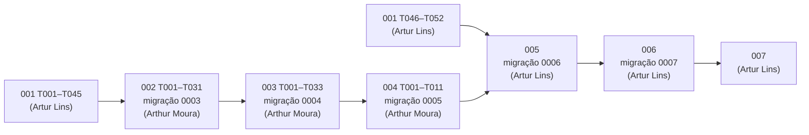

# Divisão da implementação do MVP

**Situação:** proposta de 13/10/2026, escrita por Artur Lins com agente ([registro](../prompts/2026-10-13-divisao-implementacao-mvp.md)). Fica valendo depois que **Artur Lins e Arthur Moura** concordarem e a seção [Decisões para aprovação](#decisões-para-aprovação) for respondida.

**Escopo:** implementação das specs 001 a 007 por Artur Lins e Arthur Moura. Este documento só distribui e ordena tarefas que já foram aprovadas. Ele não cria tarefa, requisito nem decisão técnica: a fonte de cada tarefa continua sendo o `tasks.md` da spec. A 007 entra quando o plano e as tarefas dela forem aprovados (regra 1).

## Princípio da divisão

A divisão segue os **domínios do backend**, e cada spec fica inteira com uma pessoa: backend, frontend, testes, quickstart e rastreabilidade. Ninguém divide uma spec em "backend de um, frontend de outro". Há três motivos:

1. **Responsabilidade:** cada pessoa responde pela spec que desenvolve, inclusive pela revisão humana do conjunto de avaliação da IA na 004 (RQ-007 e D-012 da 004).
2. **Menos conflitos:** com os domínios separados, as duas pessoas quase nunca editam o mesmo arquivo. Os pontos de contato são poucos e estão listados em [Arquivos compartilhados](#arquivos-compartilhados).
3. **Contexto:** quem cria os cartões (003 e 004) conhece as escritas disjuntas e as situações que a lição (005) consome. Quem faz a lição conhece os fatos que a gamificação (006) e a evolução (007) leem.

## Responsáveis

| Spec | Responsável | Domínios e módulos | Migração | Tarefas |
|---|---|---|---|---|
| [001](001-conta-acesso/tasks.md) conta e acesso | **Artur Lins** (em andamento) | `identidade`, `saude`, base do `nucleo`, base do frontend | `0001`, `0002` | 65 |
| [002](002-materias-fontes/tasks.md) matérias e fontes | **Arthur Moura** | `materias`, `fontes`, `nucleo/isolamento.py`, `nucleo/participantes_acervo.py`, ampliação de `nucleo/armazenamento/` | `0003` | 51 |
| [003](003-cartoes-manuais/tasks.md) cartões manuais | **Arthur Moura** | `cartoes` | `0004` | 45 |
| [004](004-geracao-cartoes/tasks.md) geração de cartões | **Arthur Moura**, também revisor do conjunto de avaliação | `ia`, `cartoes/geracao` | `0005` | 59 |
| [005](005-licao-trilha/tasks.md) lição e trilha | **Artur Lins** | `revisao`, `nucleo/dia_estudo.py`, `nucleo/eventos_revisao.py` | `0006` | 49 |
| [006](006-xp-meta-sequencia/tasks.md) XP, meta e sequência | **Artur Lins** | `gamificacao`, `nucleo/disponibilidade.py` | `0007` | 45 |
| [007](007-evolucao/README.md) evolução mínima | **Artur Lins** (padrão; ver D3) | a definir no plano | `0008`, se houver | a definir |

**Equilíbrio da carga:**

- **Artur Lins:** 159 tarefas, mais a 007.
- **Arthur Moura:** 155 tarefas, mais a revisão manual do conjunto de avaliação.

As tarefas mais arriscadas também ficam divididas. Com Arthur Moura ficam o processamento isolado de arquivos não confiáveis (002) e o provedor de IA real (004). Com Artur Lins ficam a reprodutibilidade do FSRS (005) e a liquidação da sequência (006).

**Fronteira entre as duas trilhas.** Três tarefas de Artur Lins escrevem em arquivos do domínio de Arthur Moura. Elas são as únicas exceções à separação, e Arthur Moura revisa cada uma antes do push:

| Tarefa | Arquivos tocados | Por quê |
|---|---|---|
| T005 da 005 | `app/cartoes/consultas.py` e `app/cartoes/agendamento.py` (criados) | a lição lê os cartões e grava o FSRS só por esses dois módulos (DTEC 037 e 051) |
| T026 da 006 | `app/cartoes/servicos.py` e `app/cartoes/registros.py` (ganchos), além de `app/identidade/servicos.py` | ganchos da DTEC 057 na transação de quem altera a situação de um cartão |
| T006 da 005 | `app/materias/consultas.py` (criado) | `existe_materia`, usado pela trilha |

## Caminho crítico

As dependências declaradas nos `tasks.md` formam **uma única cadeia que atravessa as duas pessoas**. Isso acontece porque as migrações são lineares (`0001` → … → `0007`) e porque a 005 consome as situações de cartão criadas pela 004:

Daí vem a regra que mais importa neste plano:

> **Arthur Moura entrega primeiro o que destrava a 005** (002 até a US1, 003 até a US3 e a base da 004) e só depois as histórias que ninguém espera (002 US2 e US3, 003 US4 e as histórias da 004).
>
> **Artur Lins usa a espera** para entregar a US3 da 001 (perfil, de que a 005 precisa) e as antecipações puras da 005 e da 006.

## Ondas

Cada onda começa quando a condição de entrada está na `develop` com a integração contínua verde. Os números das tarefas são os dos `tasks.md`.

### Onda 0: até a 001 entregar a P1

**Entrada:** agora.

| Artur Lins | Arthur Moura |
|---|---|
| 001: Fase 1, Fase 2, US1 e US2 (T001 a T045). É o mínimo de que as specs 002 a 007 precisam. | **Antecipações puras** da 002 e da 004 (ver [Antecipações](#antecipações)). Leitura dos planos da 002, da 003 e da 004 e preparo do `.env` com a chave própria do provedor de IA (regra 9). |

### Onda 1: acervo

**Entrada:** 001 T045 na `develop` (ponto de sincronização **S1**).

| Artur Lins | Arthur Moura |
|---|---|
| 001 US3 (T046 a T052), de que a 005 depende. Depois, as antecipações puras da 005 e da 006. | 002: base (T001 a T013, migração `0003`) e US1 (T014 a T031). A migração vai num commit próprio e sobe assim que passar. |

### Onda 2: cartões

**Entrada:** 002 T031 na `develop`.

| Artur Lins | Arthur Moura |
|---|---|
| 001 US4 (T053 a T059) e fase final da 001 (T060 a T065). Conclusão das antecipações que ficarem pendentes. | 003: base (T001 a T007, migração `0004`), US1, US2 e US3 (T008 a T033). Em seguida, a base da 004 (T001 a T011, migração `0005`). |

### Onda 3: lição e IA

**Entrada:** 004 T011 na `develop` (ponto de sincronização **S2**, que destrava a 005).

| Artur Lins | Arthur Moura |
|---|---|
| 005: base (T004 a T013, migração `0006`), US1 e US2 (T014 a T033), que formam o centro da apresentação. Depois, a US3 (T034 a T039). | 004: US1 e US4 (T012 a T039), a P1 da geração. Depois, a 002 US2 e US3 (T032 a T046) e a 003 US4 (T034 a T040). |
| 006: base (T004 a T013, migração `0007`), US1 (T014 a T021) e US2 (T022 a T030). A T026 é combinada com Arthur Moura antes (ver [Fronteira](#responsáveis)). | |

### Onda 4: fechamento

**Entrada:** 005 US3 e 004 US4 na `develop`.

| Artur Lins | Arthur Moura |
|---|---|
| 006 US3 (T031 a T039), 005 US4 e fases finais da 005 e da 006. A 007, se as tarefas dela estiverem aprovadas. | 004 US3 e US2 (T040 a T051), conjunto de avaliação (T052 a T054, com a revisão humana) e fases finais da 002, da 003 e da 004. |

**Reverificações entre specs:** cabem ao responsável pela spec **posterior**, que é quem tem o código real. Por exemplo, a 005 reverifica a US1-1 da 003, e a 004 reexecuta os testes da US2 e da US3 da 002 com os seus participantes (seções "Dependências" dos `tasks.md`).

## Antecipações

Os `tasks.md` da 002 em diante declaram que toda a lista depende da 001 (até a T045 ou a T052). Essa dependência existe por causa da base: banco, `conftest`, auxiliar de dono e roteamento. Algumas tarefas, porém, são **puras**: só precisam do projeto do backend (T002 da 001, já na `develop`) e não tocam banco, rotas nem arquivos compartilhados. Este plano propõe antecipá-las (D2). Só podem ser antecipadas as tarefas desta lista:

| Quem | Tarefas | Condição |
|---|---|---|
| Arthur Moura | 002: T010 (fábrica de arquivos), T014 a T017 (testes unitários de matérias, fontes, validação e divisão) e a parte pura da T024 (`fontes/dominio.py`, `validacao.py` e `divisao.py`) | `extracao.py` só depois da T001 (PyMuPDF) e da T003 (isolamento) da 002 |
| Arthur Moura | 004: T052 (dados e casos do conjunto de avaliação, fictícios), T012 e T014 (testes unitários de janela, repetição e revisão) e a parte pura da T023 (`cartoes/geracao/dominio.py`) | a T013 e os agentes só depois da T002 da 004 (PydanticAI) |
| Artur Lins | 005: T002 e T003 (`nucleo/dia_estudo.py`), T009 e T010 (contrato da `fsrs` e agendador), T011 (`nucleo/eventos_revisao.py`) e T012 (`AtalhoTeclado`, depois da T024 da 001) | `fsrs==6.3.2` já está fixada no `pyproject.toml` |
| Artur Lins | 006: T002 e T003 (`nucleo/disponibilidade.py`, com os registros vazios) e T005 (`gamificacao/regras.py`) | nenhuma |

**Regras das antecipações:**

- **Verificação:** uma tarefa antecipada só recebe `[x]` quando a verificação completa dela passa (regra 6). Se a verificação exigir a base, o código sobe, mas o checkbox espera.
- **Módulos do núcleo:** a antecipação da 005 resolve a obrigação da DTEC 048. Artur Lins cria `nucleo/dia_estudo.py`, e a 004 o reutiliza. A T002 da 005 já prevê esse caso. O mesmo vale para `nucleo/disponibilidade.py` (obrigação do plano da 006).
- **Arquivos fora do escopo:** nenhuma antecipação altera `tests/conftest.py`, `app/principal.py`, as migrações ou os testes transversais da tabela abaixo.

## Protocolo de trabalho na `develop`

As duas pessoas trabalham direto na `develop` (regra 14). Por isso, o protocolo substitui a proteção que as branches de funcionalidade dariam:

1. **Pushes pequenos e frequentes:** um commit atômico por tarefa ou parte dela (regra 16).
2. **Rebase só local:** antes de cada push, `git pull --rebase` e a suíte afetada. Nunca se reescreve o que já subiu.
3. **`develop` quebrada é prioridade:** se a integração contínua ficar vermelha, quem causou corrige antes de qualquer outra coisa ou reverte o próprio commit com `git revert`.
4. **Migrações em ordem fixa:** `0003` e `0004` (Arthur Moura) → `0005` (Arthur Moura) → `0006` e `0007` (Artur Lins). A migração vai num commit isolado, o primeiro da base de cada spec, e sobe assim que passar no teste de subida e descida. Ninguém cria migração fora dessa ordem.
5. **Arquivos gerados nunca são mesclados à mão:** `backend/openapi.json`, os tipos gerados do frontend (`npm run gerar:api`), a árvore de rotas do TanStack Router, `uv.lock` e `package-lock.json`. Num conflito, fique com a versão da `develop`, regenere (`uv lock`, `npm install` ou o comando de geração) e faça commit do resultado.
6. **Registro de prompts:** cada pessoa registra as próprias sessões (regra 7), em arquivos separados. Num conflito no índice de `docs/prompts/README.md`, mantenha as duas linhas em ordem de data.

### Arquivos compartilhados

Estes arquivos são editados pelas duas pessoas. A regra é **só acrescentar** linhas ou casos, sem reordenar nem reformatar o que já existe.

| Arquivo | Criado por | Regra de edição |
|---|---|---|
| `backend/pyproject.toml` e `uv.lock` | 001 | acrescentar dependências; o lock é regenerado |
| `tests/conftest.py` e `tests/fabricas.py` | 001 | acrescentar *fixtures*; fábricas de cada spec em arquivo próprio (`fabricas_arquivos.py`, `fabricas_cartoes.py`…) |
| `app/principal.py` e `app/worker.py` | 001 | uma linha por roteador ou tarefa, na ordem das specs |
| `app/nucleo/erros.py` | 001 | o enum `codigo` é cumulativo e nunca se renomeia um valor |
| `tests/arquitetura/test_camadas.py` | 001 | uma regra nova por bloco, com a spec citada |
| `tests/security/test_isolamento_rotas.py` e `test_csrf_origem.py` | 001 | toda rota nova entra na tabela (DTEC 019) |
| `tests/integration/test_contrato_openapi.py` | 001 | um contrato por spec |
| `frontend/src/componentes/ui/` | 001 | um componente por arquivo; os existentes só mudam com aviso ao outro |
| `compose.yaml` e `.env.example` | 001 | acrescentar serviços e variáveis, sem segredos (regra 9) |
| `docs/skills/padroes-implementacao.md` e "Mapa do repositório" do `AGENTS.md` | 001 | quem cria a estrutura registra |
| `docs/specs/README.md`, coluna "Spec" do backlog e "Estado atual" do `AGENTS.md` | | o responsável pela spec atualiza o status dela num commit `docs` |

### Pontos de sincronização

São conversas curtas entre as duas pessoas. Não são reuniões.

| Ponto | Quando | O que se combina |
|---|---|---|
| **S1** | 001 T045 na `develop` | contrato de base: `conftest`, auxiliar de dono, erros, roteamento e tokens de design. Arthur Moura passa da antecipação para a base da 002. |
| **S2** | 004 T011 na `develop` | Artur Lins começa a 005. Revisão conjunta da T005 da 005 (consultas e agendamento em `cartoes`). |
| **S3** | antes da T026 da 006 | ganchos da DTEC 057 em `cartoes` e `identidade`. Combinar o momento, para não colidir com a 003 US4 em curso. |
| **S4** | véspera de cada apresentação | suíte completa na `develop` e merge para a `main` só com tudo passando (regra 17). |

## Escopo por data de apresentação

As datas possíveis são 15/10, 20/10 e 22/10/2026, com meta em 15/10. São cerca de 310 tarefas para duas pessoas. O MVP inteiro em 15/10 é improvável, por isso a proposta (D4) separa um corte demonstrável:

| Data | Corte proposto | Justificativa |
|---|---|---|
| **15/10** | 001 US1 a US3; 002 US1; 003 US1 a US3; base da 004; 005 US1 e US2 com cartões manuais (a estratégia de incremento da 005 já prevê isso); 006 US1 e US2, se der tempo | É o ciclo central do produto: conta → matéria e fonte → cartão → lição com FSRS e explicação ao errar → XP e meta. |
| **20/10** | MVP completo: geração por IA com o conjunto de avaliação, trilha, sequência, histórias P2 e P3 e 007 | A 004 depende do provedor real e da revisão humana do conjunto (T054). A 007 depende do plano em andamento. |

## Riscos

| Risco | Efeito | Mitigação |
|---|---|---|
| Atraso na base da 002, da 003 ou da 004 | a 005 (Artur Lins) fica parada | a ordem da trilha de Arthur Moura prioriza o desbloqueio; Artur Lins tem como folga as antecipações e a 001 US3, US4 e fase final |
| Edição concorrente de arquivos compartilhados | conflitos e `develop` quebrada | só acrescentar, pushes pequenos e regeneração dos arquivos gerados |
| T005 da 005 e T026 da 006 no domínio do outro | regras de `cartoes` violadas sem perceber | revisão de Arthur Moura antes do push (S2 e S3) |
| Cota gratuita do provedor de IA | a geração real e a T054 travam | chave própria de cada pessoa no `.env`; testes com `FunctionModel` (`ALLOW_MODEL_REQUESTS = False`) |
| Plano da 007 ainda em escrita | a 007 não começa | a 007 só entra na Onda 4, com as tarefas aprovadas (regra 1) |

## Decisões para aprovação

| ID | Decisão | Recomendação | Alternativa |
|---|---|---|---|
| D1 | Divisão por domínio: Artur Lins com 001, 005, 006 e 007; Arthur Moura com 002, 003 e 004 | **Adotar.** Menos conflitos, carga equilibrada e cada pessoa responde por specs inteiras. | Alternar as specs (001, 003 e 005 com um; 002, 004 e 006 com o outro). Isso cruza os domínios `cartoes` e `revisao` e multiplica os pontos de contato. |
| D2 | Antecipar só as tarefas puras listadas, apesar da dependência geral declarada nos `tasks.md` | **Adotar.** Sem isso, Arthur Moura fica ocioso até a 001 T045 e Artur Lins fica ocioso até a 004 T011. | Seguir a dependência ao pé da letra e aceitar a ociosidade. |
| D3 | A 007 fica com Artur Lins | **Adotar**, salvo se a pessoa que está escrevendo o plano da 007 for implementá-la. A 007 lê só as consultas da 005 e da 006. | Quem estiver livre primeiro depois da 006 T036. |
| D4 | Corte de 15/10 conforme a tabela acima | **Adotar.** O MVP inteiro em dois dias não é realista. | Apresentar em 20/10 com o MVP completo. |

Depois da aprovação, cada responsável escreve o próprio nome no campo "Responsável pela implementação" do plano da spec, ao começar a implementação (T001 da 004, da 005 e da 006).
